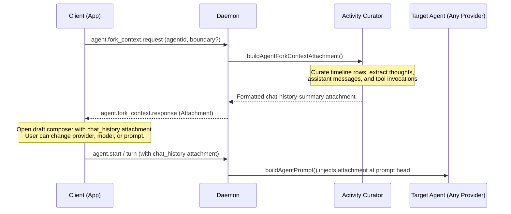

# Cross-Provider Agent Fork Mechanism

Paseo allows users to fork an active or completed agent session into a new session, with the option to choose a completely different agent provider (such as switching from Claude Code to Codex, OpenCode, Pi, or custom ACP agents).

This document covers the architecture, timeline curation, and cross-provider context injection pipeline.

---

## Architecture Principles

Agent providers (Claude Code, Codex, OpenCode, Pi, ACP) maintain incompatible internal session state, proprietary SQLite databases, and diverging process lifecycles. Trying to deserialize or reconstruct native session states across providers is unviable.

Paseo treats forking as context distillation rather than native session resumption:

- **No native session branching**: Forking does not branch or resume the provider's native session state. The source session continues running untouched.
- **Projected timeline curation**: The daemon curates the source agent's projected timeline into a standardized, character-budgeted summary attachment (`chat_history`).
- **Provider decoupling**: The new agent receives the curated history as a prompt attachment at turn start. Any provider that supports text prompt blocks can consume it without custom migration logic.

---

## Data Flow



---

## Execution Phases

### 1. Trigger and Boundary Determination

The user triggers a fork from the assistant turn footer via [AssistantForkMenu](file:///Volumes/ExternalSSD/Workspace/PaseoData/worktrees/1fkfpn5w/unbiased-lionfish/packages/app/src/components/assistant-fork-menu.tsx), selecting either "Fork in new tab" or "Fork in new workspace".

Context capture supports two boundary states:

- **Completed turn**: The client passes the turn's `boundaryMessageId` and `boundaryCursor`. The backend extracts history strictly up to that turn boundary.
- **In-flight (streaming) turn**: The client omits the boundary arguments. When boundary options are omitted, `selectForkContextRows` projects the entire timeline up to the current moment, capturing content that is still actively streaming.

Client orchestration is managed in [useForkAgent](file:///Volumes/ExternalSSD/Workspace/PaseoData/worktrees/1fkfpn5w/unbiased-lionfish/packages/app/src/hooks/use-fork-agent.ts).

### 2. Activity Curation

On receiving `agent.fork_context.request`, the session invokes [buildAgentForkContextAttachment](file:///Volumes/ExternalSSD/Workspace/PaseoData/worktrees/1fkfpn5w/unbiased-lionfish/packages/server/src/server/agent/activity-curator.ts#L335):

1. **Item selection**: Timeline rows up to the boundary cursor are gathered and passed to `curateProjectedActivityEntries`.
2. **Text transformation**: Timeline items are formatted into normalized text blocks:
   - User messages: Raw text.
   - Assistant responses: `[Assistant] <text>`.
   - Reasoning / CoT: `[Thought] <text>`.
   - Tool calls: `[<ToolName>] <summary/inputJson>`.
3. **Character budget fitting**: Total text is budgeted against `MAX_FORK_CONTEXT_CHARS` (100,000 characters). When history exceeds the budget, earlier entries are dropped and prefixed with `[Earlier chat history omitted]`.
4. **Envelope**: Entries are wrapped inside an envelope block:

   ```xml
   <chat-history-summary>
   Chat history from a previous Paseo agent.
   Source agent: <Agent Title>
   Source directory: <CWD>

   <Curated Entries>
   </chat-history-summary>
   ```

5. **Attachment generation**: Emitted as a standard `type: "text"` attachment with `contextKind: "chat_history"`.

### 3. Draft Composer Staging

The client loads the attachment into the workspace attachment store as a `WorkspaceComposerAttachment` (`kind: "chat_history"`):

- Source agent metadata (such as working directory `cwd` and existing feature values) pre-populates the new draft setup.
- The composer UI displays the chat history as an attachment pill.
- The user is free to change the agent provider, model, execution mode, or accompanying prompt before initiating the run.

### 4. Cross-Provider Prompt Ingestion

When the user submits the draft:

1. **Attachment hoisting**: [buildAgentPrompt](file:///Volumes/ExternalSSD/Workspace/PaseoData/worktrees/1fkfpn5w/unbiased-lionfish/packages/server/src/server/agent/prompt-attachments.ts#L7) hoists `contextKind: "chat_history"` attachments to the front of the prompt block array, before any user text, images, or review attachments.
2. **Provider adapter conversion**: Provider implementations (such as [Claude](file:///Volumes/ExternalSSD/Workspace/PaseoData/worktrees/1fkfpn5w/unbiased-lionfish/packages/server/src/server/agent/providers/claude/agent.ts), [Codex](file:///Volumes/ExternalSSD/Workspace/PaseoData/worktrees/1fkfpn5w/unbiased-lionfish/packages/server/src/server/agent/providers/codex-app-server-agent.ts), [OpenCode](file:///Volumes/ExternalSSD/Workspace/PaseoData/worktrees/1fkfpn5w/unbiased-lionfish/packages/server/src/server/agent/providers/opencode-agent.ts), and [Pi](file:///Volumes/ExternalSSD/Workspace/PaseoData/worktrees/1fkfpn5w/unbiased-lionfish/packages/server/src/server/agent/providers/pi/agent.ts)) pass all blocks through [renderPromptAttachmentAsText](file:///Volumes/ExternalSSD/Workspace/PaseoData/worktrees/1fkfpn5w/unbiased-lionfish/packages/server/src/server/agent/prompt-attachments.ts#L40).
3. **Execution**: The rendered XML summary block is prepended directly to the first user message sent to the newly instantiated agent CLI or API.

---

## Code Reference

| Area                 | Path                                                                                                                                                                                                  | Responsibility                                               |
| :------------------- | :---------------------------------------------------------------------------------------------------------------------------------------------------------------------------------------------------- | :----------------------------------------------------------- |
| **UI Trigger**       | [packages/app/src/components/assistant-fork-menu.tsx](file:///Volumes/ExternalSSD/Workspace/PaseoData/worktrees/1fkfpn5w/unbiased-lionfish/packages/app/src/components/assistant-fork-menu.tsx)       | Turn footer menu and trigger action                          |
| **Client Hook**      | [packages/app/src/hooks/use-fork-agent.ts](file:///Volumes/ExternalSSD/Workspace/PaseoData/worktrees/1fkfpn5w/unbiased-lionfish/packages/app/src/hooks/use-fork-agent.ts)                             | RPC call, draft setup, and attachment staging                |
| **Activity Curator** | [packages/server/src/server/agent/activity-curator.ts](file:///Volumes/ExternalSSD/Workspace/PaseoData/worktrees/1fkfpn5w/unbiased-lionfish/packages/server/src/server/agent/activity-curator.ts)     | Timeline extraction, budget fitting, and XML envelope        |
| **Session RPC**      | [packages/server/src/server/session.ts](file:///Volumes/ExternalSSD/Workspace/PaseoData/worktrees/1fkfpn5w/unbiased-lionfish/packages/server/src/server/session.ts)                                   | `agent.fork_context.request` handler                         |
| **Prompt Assembly**  | [packages/server/src/server/agent/prompt-attachments.ts](file:///Volumes/ExternalSSD/Workspace/PaseoData/worktrees/1fkfpn5w/unbiased-lionfish/packages/server/src/server/agent/prompt-attachments.ts) | Front-hoisting `chat_history` attachments into prompt blocks |
